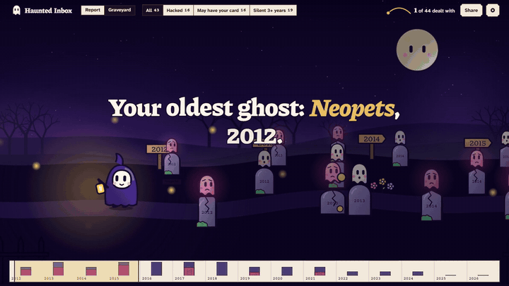
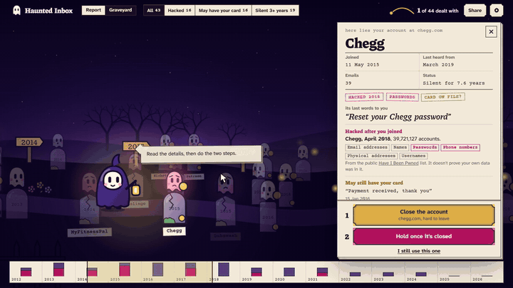

# Haunted Inbox

**You forgot them. They didn't forget you.**

Every account your past self made is still out there, holding your name, your email, sometimes your card. Haunted Inbox finds them from your own mail, on your own computer, and lays them out as a graveyard you can walk through: one stone for every account, on the day you signed up, with a ghost above it.

You get a plain report first: what it found, the riskiest account, and a link to where you can delete each one. The graveyard is the same accounts, one click away: each stone tells you what that account still knows, whether it was hacked after you joined, and what its **last words** to you were. Lay one to rest and the sky gets a little lighter. Clear the graveyard and it's morning.

Walk through a sample, no install: **https://haunted.celebrable.tech**





## Run it on your own mail

You need [Python 3.12](https://www.python.org/downloads/) and [Ollama](https://ollama.com/download). Nothing else to install.

```bash
git clone https://github.com/nirajkhetre/haunted-inbox
cd haunted-inbox
ollama pull gemma4:e2b
python -m haunted serve
```

The page opens at `127.0.0.1:7666`. Then either:

- **Drop a Google Takeout `.mbox` file** on it (Mail only). The most complete, though the export can take a while to arrive.
- **Or use an app password**, right now, with Gmail, Yahoo, iCloud, Fastmail, AOL or Zoho. The connection is read-only.

## What it reads, and what it doesn't

Only the envelope of each email: who sent it, when, and the subject. **Never the message.** Spam, drafts and sent mail are skipped.

| | Where it goes |
|---|---|
| Your mail's envelopes | Stay on your computer. A local model reads them through `127.0.0.1` |
| Your app password | Kept in memory for the scan, never saved |
| A dropped export | Deleted as soon as its envelopes are read |
| The public lists of hacks and delete links | Bundled in the repo, so nothing is looked up about you |
| "What became of this company?" (optional, needs a key) | Sends only the company's public name to a web search |

The server only listens on `127.0.0.1`, and refuses other sites and anything but JSON, so a web page you happen to have open can't reach it.

## How it decides

The model reads, plain code decides.

1. **Group.** Code turns the mailbox into one short card per sender: their name, how many emails, the first and last dates, and up to 8 subject lines.
2. **Read.** A small open model, running locally, answers one question per card: is this an account, a newsletter, a person, or something else?
3. **Decide.** Everything you're told as a fact comes from code:
   - when you joined is the date of the first email;
   - a hack counts only if it happened **after** you joined, checked against the [Have I Been Pwned](https://haveibeenpwned.com/) list;
   - the delete link comes from [JustDeleteMe](https://justdeleteme.xyz/);
   - the words shown as proof, and the last words, are always your own subject lines, never written by a model.

## Does it work?

A hand-written test of 102 senders, frozen in git ([`ml/frozen.py`](ml/frozen.py)). It's deliberately hard: 14 accounts whose mail has no keyword at all, 22 accounts in other languages, 10 newsletters that use words like "password" and "order", and 6 scams.

| Reader | Accounts found | False alarms | Accounts with no keyword | Other languages |
|---|---:|---:|---:|---:|
| Searching for "welcome", "verify", "password" (the usual advice) | 13 / 56 | 15 / 46 | 0 / 14 | 0 / 22 |
| Gemma on this laptop, first prompt | 49 / 56 | 7 / 46 | 7 / 14 | 22 / 22 |
| Gemma on this laptop, current prompt | 52 / 56 | 5 / 46 | 12 / 14 | 20 / 22 |

The third row is flattered: I changed the prompt after seeing what the second row got wrong, on this same test. The first two rows scored the model's answer alone; the third scores the whole path to a ghost.

On the made-up sample mailbox (3,951 emails), it finds 44 of the 46 real accounts with no false alarms.

**On a real inbox it does worse, and that's the number to trust.** I scanned my own mail (7,556 emails, 311 senders, 129 seconds), then marked 200 senders by hand on a page that hides what the model said. I skipped 34 I couldn't remember, leaving 166.

| Reader | Accounts found | False alarms |
|---|---:|---:|
| Searching for keywords | 65 / 159 | 3 / 7 |
| Gemma | 101 / 159 | 3 / 7 |

Where they disagreed, Gemma was right 45 times and keyword search 9 (McNemar p < 0.001). But Gemma found 64% of the accounts here against 93% on the frozen test. Of its 58 misses, it called 53 a newsletter, and I had marked those as "yes, I signed up". With only 7 senders marked "no", the false alarm numbers say very little. It's one person's inbox, marked by that person. Totals are in [`ml/results/real-inbox.json`](ml/results/real-inbox.json); nothing from the mailbox itself is in this repo.

**"What became of this company?"** uses [SerpApi](https://serpapi.com) for live search. Code finds a sentence in the results that names the company and says it was sold or closed, the right way round, and the local model only confirms it. On the sample's 44 ghosts it found 13 sales, for 124 searches in all, my failed first attempts included. I read all 13: 12 look right, including Microsoft buying LinkedIn and Bending Spoons buying Evernote, and 1 was the wrong Notion, a different company with the same name. It also missed sales it should have found, like Neopets. So the card says "found by web search, so check it", and that wrong one is left out of the demo.

Run it yourself:

```bash
python ml/evaluate.py trick gemma4:e2b
python -m unittest tests.test_core
```

## Limits

- A newsletter you signed up for often gets read as "just a newsletter", not an account. That was most of its misses on my own mail.
- It finds accounts that **emailed you**. One you signed up for with a different address, or one that never wrote, stays hidden.
- It can't delete anything for you. It takes you to the door.
- "Hacked after you joined" doesn't prove your data was in the leak. It says the place you were in was hit.
- The joined date is the first email in *this* mailbox, so it can be later than the real one.
- A company's name can belong to someone else: web search can confuse two companies called the same thing.
- Scams are the weakest spot: it still let 3 of the 6 in the test through. Your mail provider's spam filter does most of that work, and the spam folder is skipped.

## Credits

- Breach list: [Have I Been Pwned](https://haveibeenpwned.com/) (CC BY 4.0). Delete links: [JustDeleteMe](https://github.com/jdm-contrib/jdm) (MIT). Details in [`haunted/data/SOURCES.md`](haunted/data/SOURCES.md).
- Model: [Gemma](https://ai.google.dev/gemma), run with [Ollama](https://ollama.com).
- Fonts: Piazzolla, Atkinson Hyperlegible Next, Courier Prime (SIL Open Font License), in `haunted/ui/fonts`.

MIT licensed.
